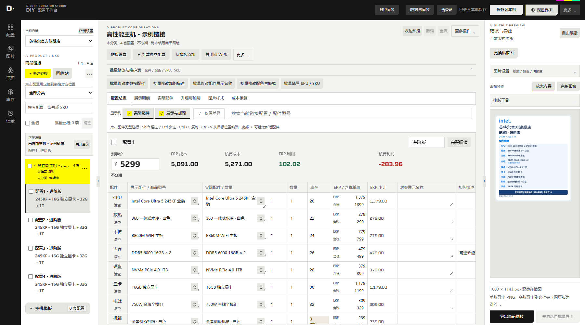
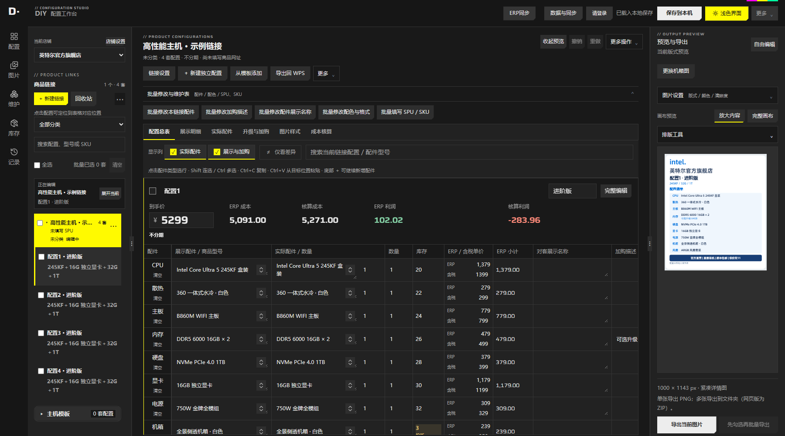
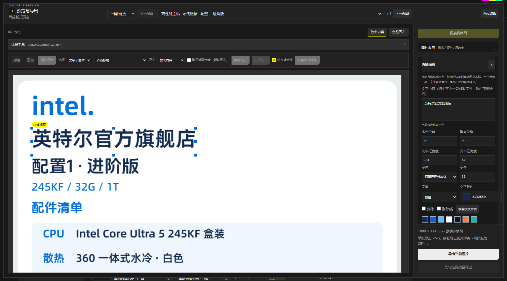

# DIY 配置工作台

面向 DIY 整机业务的 Windows 工作台。按店铺和商品链接集中维护配置、配件、库存与利润，批量更新说明，制作配置清单图和 SKU 图。

**Windows x64 · 当前版本 0.2.30 · 解压即用**

连续表格直接编辑和复制配件；底部新增配件行，支持删除与撤销；自由编辑画布和属性分区显示。浅色、深色界面随时切换，多配置滚动、输入和换色响应已优化。

## 下载与开始使用

| 下载入口 | 说明 |
| --- | --- |
| **[下载 Windows 使用包 · Gitea](https://gitea.cq360.top/CoreStudio/diy-tools-refactor/releases/download/refactor-v0.2.30/DIYTools-0.2.30-Windows-x64.zip)** | 推荐下载，完整解压后运行 DIYTools.exe |
| [下载同一使用包 · GitHub](https://github.com/yamakaze1234/diytools-refactor/releases/download/refactor-v0.2.30/DIYTools-0.2.30-Windows-x64.zip) | 备用下载源 |
| [本次更新说明](https://gitea.cq360.top/CoreStudio/diy-tools-refactor/releases/tag/refactor-v0.2.30) | 完整变化和下载附件 |

1. 下载并完整解压到可写目录，不要直接在压缩包内运行。
2. 无团队配置时使用本机模式；团队成员登录后，按提示下载资料或迁移旧数据。
3. 选择店铺、链接和配置，编辑配件与价格，确认保存状态后导出。

需要 Windows x64 和 Microsoft Edge WebView2 Runtime；使用者无需安装 Node.js、Rust 或 Python。便携版资料存放于程序旁的 data。已有用户通过“更多 → 检查更新”升级，更新保留原有数据与本机接入配置。

## 界面例图

以下为当前工作台的真实界面截图，使用合成商品、配件、价格和库存，仅用于展示操作布局。

### 浅色界面

### 深色界面

### 自由编辑

[查看界面与操作说明](docs/UI-GUIDE.md)

## 可以做什么

| 功能 | 使用方式 |
| --- | --- |
| 连续编辑 | 同一链接的配置连续显示，直接搜索展示/实际配件，编辑数量、独立核算价、展示名称和加购描述 |
| 配件复制与增删 | 点击行名选行，Shift 连选、Ctrl 多选，复制后按目标位置粘贴；底部新增配件6及后续行，新增行可删除，固定栏位可清空 |
| 库存与利润 | 显示实际配件库存、ERP/核算成本及利润；区分缺货、低库存和未知，分期扣费前后利润分别显示 |
| 批量维护 | 按链接或店铺批量修改配件、加购说明、展示名称、配色格式和平台 ID，预览后应用 |
| 输出源维护 | 分别查看本次变动和待确认差异，保留手动内容或采用源更新，支持对应图片导出 |
| 配置与 SKU 图片 | 自由编辑文字和布局；选择全部或仅变动配置导出，预览支持放大内容和完整画布 |
| WPS 与 ERP | WPS 复制数量、展示名称和到手价到 F:H；ERP 成本库存和核算成本提供只读预览后应用 |
| 数据维护 | 本机保存、历史、恢复草稿、备份、选择店铺同步和本机缓存清理 |
| AI / CLI | 主程序自动准备本机 CLI，支持查询、预览修改、批量导出和显式同步 |

界面深浅色与配置图片主题分别设置。配置名称不会因增删自动重新编号；需要时使用“一键重新编号”。编辑器可保存配件8及更多行，既有 ERP 固定格式仍最多到配件7，超出时会提示处理，不会静默截断。

## 文档导航

- [界面与操作](docs/UI-GUIDE.md)：区域分工、行编辑、自由编辑与主题。
- [使用说明](docs/PUBLIC-USAGE.md)：首次使用、批量、导出、同步、备份与更新。
- [成本与库存](docs/COST-SYNC.md)：ERP 库存和核算成本来源。
- [本机接入](docs/PUBLIC-INTEGRATIONS.md)：团队服务和可选 ERP。
- [AI 与 CLI](docs/AGENT-TOOLS.md)：本机查询、修改预览和导出协议。
- [系统架构](docs/PUBLIC-ARCHITECTURE.md) · [源码开发](docs/DEVELOPMENT.md) · [发布维护](docs/PUBLIC-RELEASE.md)。

发行包仅包含主程序、便携标记和使用说明。团队账号、连接配置、业务库和私有 ERP 组件不随公开包分发。

[Gitea 主仓库](https://gitea.cq360.top/CoreStudio/diy-tools-refactor) · [GitHub 镜像](https://github.com/yamakaze1234/diytools-refactor) · [版本历史](https://gitea.cq360.top/CoreStudio/diy-tools-refactor/releases)

本项目尚未指定开源许可证；第三方依赖和素材遵循各自许可。
