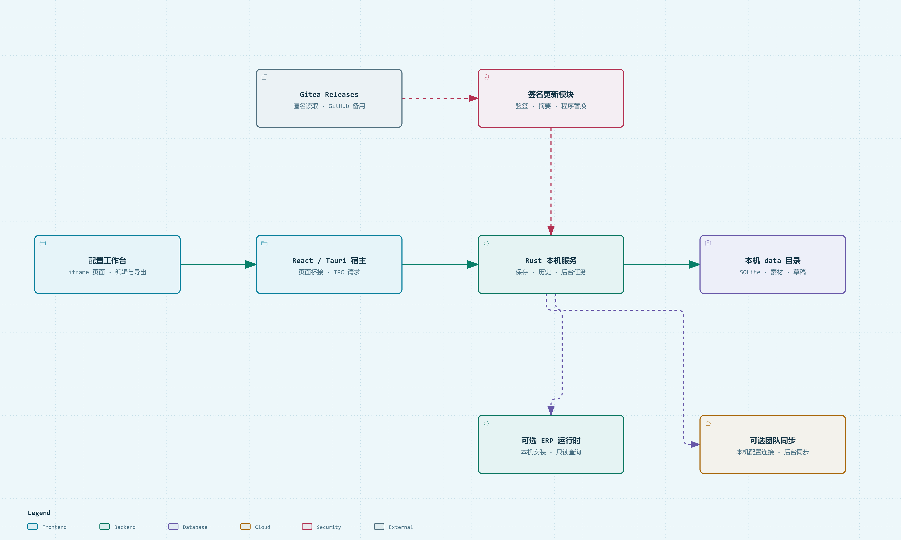

# DIY 配置工作台

面向 DIY 整机业务的 Windows 工作台。集中管理商品配置、配件成本与利润，批量维护配件和加购说明，制作配置清单图与 SKU 图。

**Windows x64 · 当前版本 0.2.26 · 解压即用**

本次更新：修复首次同步因云端缺少快照而中断，并修复价格弹窗关闭后主编辑页签无法切换。

## 系统架构

[查看架构说明](docs/PUBLIC-ARCHITECTURE.md)

## 下载与开始使用

| 下载入口 | 说明 |
| --- | --- |
| **[下载 Windows 首次使用包 · Gitea](https://gitea.cq360.top/CoreStudio/diy-tools-refactor/releases/download/refactor-v0.2.26/DIYTools-0.2.26-Windows-x64.zip)** | 推荐下载，完整解压后运行 `DIYTools.exe` |
| [下载同一使用包 · GitHub](https://github.com/yamakaze1234/diytools-refactor/releases/download/refactor-v0.2.26/DIYTools-0.2.26-Windows-x64.zip) | 备用下载源 |
| [版本历史 · Gitea](https://gitea.cq360.top/CoreStudio/diy-tools-refactor/releases) / [GitHub](https://github.com/yamakaze1234/diytools-refactor/releases) | 更新内容与历史程序 |

1. 下载 ZIP，完整解压到可写目录，再运行 `DIYTools.exe`；不要直接在压缩包中运行。
2. 无团队接入配置时使用本机模式。团队用户由管理员配置连接，用自己的成员账号登录，再选择云端下载或旧数据迁移。
3. 选择店铺、商品链接和配置，编辑后保存；按需要导出图片或复制到 WPS。

需要 Windows x64 和 Microsoft Edge WebView2 Runtime，不需要安装 Node.js、Rust 或 Python。便携版数据保存在程序旁的 `data`。已有用户可通过“更多 → 检查更新”升级并保留数据。

## 可以做什么

| 功能 | 使用方式 |
| --- | --- |
| 配置管理 | 按店铺和链接管理多套配置，维护实际配件、展示内容、价格与利润 |
| 批量修改 | 更换配件、修改加购说明和展示名称，先预览再应用，支持本次修改单次还原 |
| 差异确认 | 按配件分类查看输出源变化，相同描述变动成组选择 |
| 图片导出 | 配置图和 SKU 图，保留各套主题，选择全部或仅变动配置导出；文件名如 `1_配置1.png` |
| WPS 回填 | 勾选配置，复制数量、展示名称和到手价到 F:H |
| 数据维护 | 本机历史、恢复草稿、备份与缓存管理；可选接入团队同步、ERP 只读查询 |

## 文档

- [使用说明](docs/PUBLIC-USAGE.md)：首次使用、批量操作、图片、备份与更新。
- [接入说明](docs/PUBLIC-INTEGRATIONS.md)：团队同步和可选 ERP 配置。
- [源码开发](docs/DEVELOPMENT.md)：环境、运行、测试和构建。
- [系统架构](docs/PUBLIC-ARCHITECTURE.md) · [发布维护](docs/PUBLIC-RELEASE.md)。

发行包仅包含程序、便携标记和使用说明。团队连接、成员账号、业务数据和私有 ERP 组件由管理员在本机配置。

[Gitea 主仓库](https://gitea.cq360.top/CoreStudio/diy-tools-refactor) · [GitHub 镜像](https://github.com/yamakaze1234/diytools-refactor)

本项目尚未指定开源许可证；第三方依赖和素材遵循各自许可。
