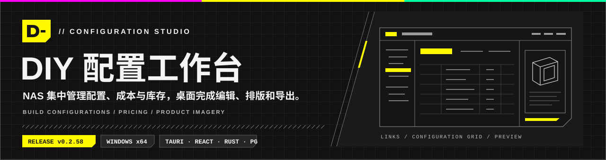
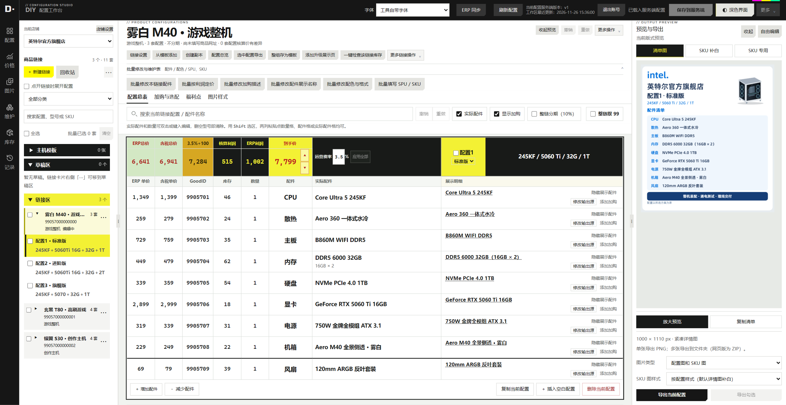
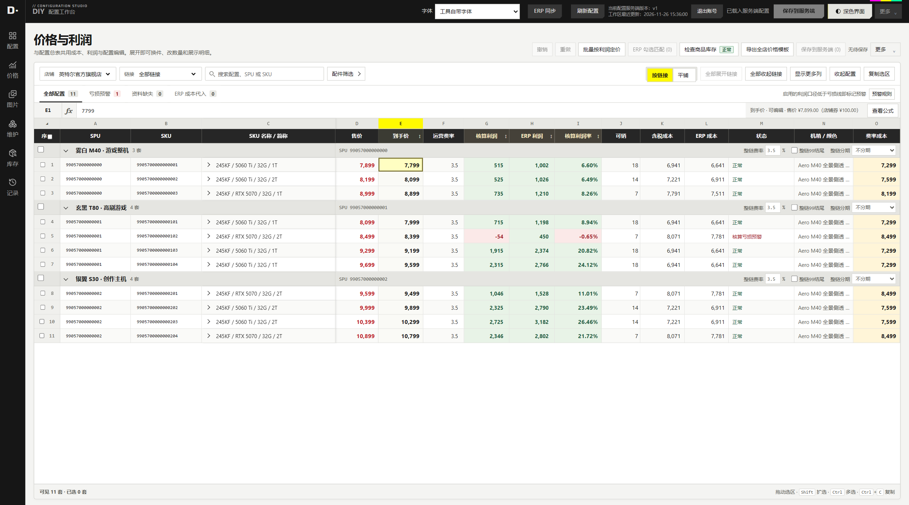
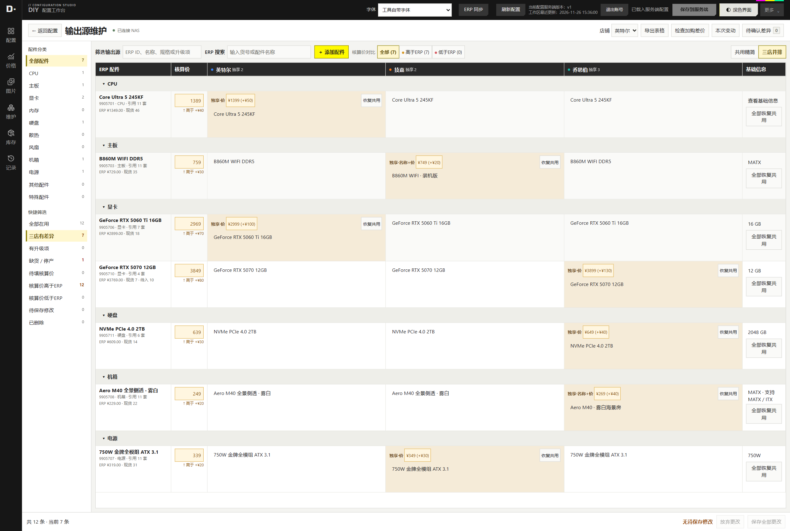
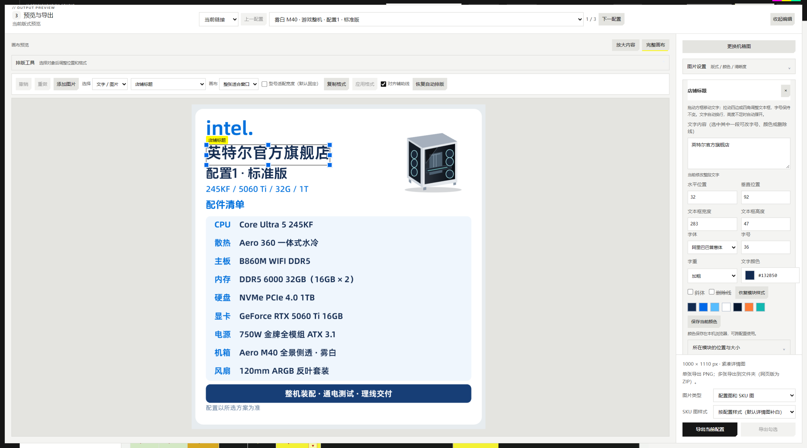
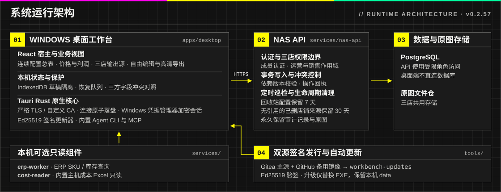

  

  
  
  
  
  

面向 DIY 整机运营的 Windows 工作台，在同一处完成三店选件、定价和商品图交付。

[立即下载](#立即下载) · [界面预览](#界面预览) · [核心能力](#核心能力) · [系统架构](#系统架构) · [文档中心](#文档中心)

## 立即下载

| 发行入口 | 适用场景 | 通道与校验 |
| --- | --- | --- |
| [Windows 使用包 · Gitea](https://gitea.cq360.top/CoreStudio/diy-tools-refactor/releases/download/workbench-v0.2.57/DIY%E5%B7%A5%E4%BD%9C%E5%8F%B0-0.2.57.zip) | Windows x64 首次使用，完整解压 | 主源 · 签名清单见 Gitea 发行页 |
| [Windows 使用包 · GitHub](https://github.com/yamakaze1234/diytools-refactor/releases/download/workbench-v0.2.57/DIY-0.2.57.zip) | 主源下载不便时使用 | 备用源 · 签名清单见 GitHub 发行页 |
| [Gitea Releases](https://gitea.cq360.top/CoreStudio/diy-tools-refactor/releases) · [GitHub Releases](https://github.com/yamakaze1234/diytools-refactor/releases) | 查看版本和附件 | [0.2.57 更新说明 · Gitea](https://gitea.cq360.top/CoreStudio/diy-tools-refactor/releases/tag/workbench-v0.2.57) · [GitHub](https://github.com/yamakaze1234/diytools-refactor/releases/tag/workbench-v0.2.57) |

首次连接 4 步

1. 完整解压到独立可写目录，运行 `DIY配置工作台.exe`。
2. 向管理员获取 NAS HTTPS 服务地址及所需的 CA。
3. 填写连接名称和服务端地址，按需选择自定义 CA，测试成功后保存并重启。
4. 使用工作台成员账号登录，按需保留登录信息。

以后从「更多 → 连接设置」修改连接，从「更多 → 检查更新」升级。新版更新先通过 Ed25519 签名检查，再校验附件长度和 SHA-256，仅替换 EXE，保留连接设置和 `data`。

系统要求与旧版通道

需要 Windows x64 和 Microsoft Edge WebView2 Runtime。正式客户端连接启用成员认证的三店 NAS 服务。部署与接入见 [NAS 服务](services/nas-api/README.md) 和 [客户端接入](docs/NAS-CLIENT.md)。

正式版使用 `workbench-updates`。旧 `refactor-updates` 通道已冻结，首次切换请使用独立目录并保留旧数据目录，按需联系管理员迁移。

## 界面预览

四张例图均使用合成配置、价格、成本、库存及机箱示意图。

  

查看价格利润、三店输出源和海报排版

**价格与利润**

**全屏输出源维护**

**自由编辑与高清导出**

查看完整操作入口与步骤。[界面与操作指南](docs/UI-GUIDE.md)

## 核心能力

| 业务模块 | 能力 |
| --- | --- |
| 连续配置编辑与草稿保护 | 按店铺和商品链接编辑连续配置总表，维护展示与实际配件、数量、加购和到手价。本机草稿按连接、账号和店铺隔离，支持恢复未提交编辑。 |
| 三店共用输出源与核算价体系 | 在全屏工作表维护共用和单店字段，按核算价与 ERP 价筛选或三店并排核对。新增配件优先取成本表核算价，缺价时暂用 ERP 价，成本同步保留单店手动核算价。 |
| 价格利润、库存与 ERP 协同 | 汇总到手价、运营费率、核算与 ERP 成本，按目标利润反推售价。查可销、待入和在途库存，可先核对配置差异再启动后台 ERP 匹配。 |
| 可视化海报排版与批量高清导出 | 实时预览配置图和 SKU 图。自由编辑支持拖动与调整对象属性，可将选中配置批量导出为高清 PNG。导出图与工作台分别设置深浅主题。 |
| 多端并发安全、定时清理与签名更新 | NAS 事务写入与版本校验保护并发操作，冲突可按字段对照编辑基线、本机草稿与服务端最新值。回收站配置保留 7 天，已删除且无引用的店铺专属输出源保留 30 天，到期自动清理，审计记录与原图永久保留。Windows 更新经 Ed25519 验签。 |

## 系统架构

正式客户端通过 HTTPS 接入 NAS API，由服务端按成员和店铺权限访问 PostgreSQL。桌面端不直连数据库。详细模块和数据位置见 [项目结构与系统架构](docs/PUBLIC-ARCHITECTURE.md)。

| 目录 | 职责 |
| --- | --- |
| `apps/desktop` | React 宿主、配置与海报编辑、Tauri Rust 原生层 |
| `services/nas-api` | 三店认证与权限、业务事务、PostgreSQL 迁移和部署 |
| `services/erp-worker` | 本机 ERP 配件 SKU 与库存查询组件 |
| `services/cost-reader` | 内置主机成本 Excel 只读组件 |
| `packages` | 共享模块与正式包内置的 Agent CLI |
| `tools` | 公开树审计、本地构建、验签与发行工具 |
| `docs` | 使用、部署、开发与发行文档 |

## 文档中心

| 角色 | 文档 |
| --- | --- |
| 运营与日常使用 | [界面与操作指南](docs/UI-GUIDE.md) · [使用说明](docs/PUBLIC-USAGE.md) · [成本同步](docs/COST-SYNC.md) |
| 管理员与部署 | [客户端接入](docs/NAS-CLIENT.md) · [NAS API 部署](services/nas-api/README.md) · [签名发布](docs/PUBLIC-RELEASE.md) · [发行与仓库配置模板](docs/RELEASE-TEMPLATE.md) |
| 开发者与自动化 | [系统架构](docs/PUBLIC-ARCHITECTURE.md) · [源码开发](docs/DEVELOPMENT.md) · [Agent 工具](docs/AGENT-TOOLS.md) · [MCP](docs/MCP.md) |

## 仓库与许可

[Gitea 主仓库](https://gitea.cq360.top/CoreStudio/diy-tools-refactor) · [GitHub 备用发行源](https://github.com/yamakaze1234/diytools-refactor)

本项目尚未指定开源许可证，第三方依赖和素材遵循各自许可。
