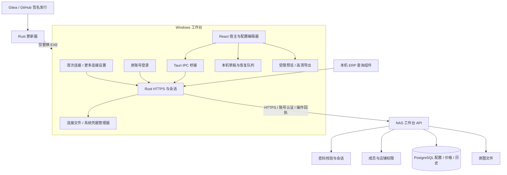
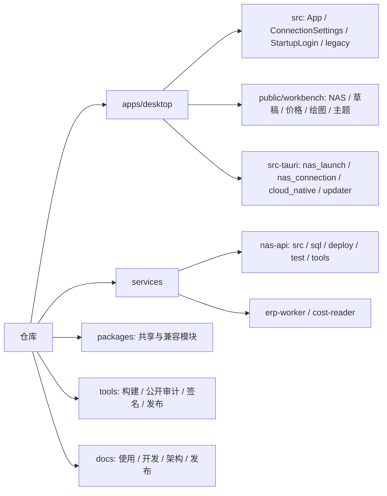

# 项目结构与系统架构

当前正式构建启用 `formal-nas-client,agent-tools`，并内置同一源码构建的 Agent CLI。React 与原工作台页面共享业务操作，Rust 提供网络、凭据、文件和更新能力。配置业务数据集中在 NAS PostgreSQL，原图保存在 NAS 文件目录。

## 运行结构图

## 源码结构图

草稿保存由 `nas-draft-controller.js` 管理。仅明确拒绝的依赖版本冲突可读取最新基线并有限重试；同配置版本变化和未知回执继续拦截。`nas-conflict-view.js` 按稳定配件行号展示开始编辑时、本机草稿和服务器最新值，不执行隐式合并。

## 关键边界

| 模块 | 当前职责与入口 |
| --- | --- |
| 连接设置 | `nas_launch.rs` 在线程启动前读配置；`nas_connection.rs` 匿名 TLS 检查和原子落盘；重启切换 |
| 身份与权限 | `cloud_transport.rs` 处理原生会话，`nas-api/src/local-auth.mjs` 验证 NAS 凭据，店铺作用域沿用原授权 |
| 编辑与恢复 | `nas-main-workspace.js`、`nas-draft-controller.js`、`nas-operation-plan.js` 按端点、部署、成员隔离草稿和回执 |
| 配置清单与定价 | 价格表沿用摘要索引的配置顺序，完整详情用于利润计算。批量按利润定价按所选范围补齐详情 |
| 输出源维护 | `shared-source-editor.js` 投影各店生效字段，`source-editor.js` 暂存字段恢复并沿用原共用目录提交机制 |
| PostgreSQL | `services/nas-api/src` 通过受限角色操作各店数据；SQL 与部署模板不带生产密码 |
| 图片 | 预览分辨率受限，旧画布释放，原图缓存有数量和体积上限；导出生成高清图 |
| 更新 | `workbench-updates` / `workbench-vX.Y.Z`，Ed25519 验签后检查长度和 SHA-256，保留 data |
| 旧版兼容 | 本机 SQLite、迁移及旧同步代码仍被兼容构建/测试引用；正式 NAS 启动不进入这些路径 |

## 数据位置

| 内容 | 位置 |
| --- | --- |
| 服务端配置、成本、价格与利润历史、回收站 | NAS PostgreSQL；自动清理尚未上线 |
| 上传的原图 | NAS 文件存储及数据库元信息 |
| 本机草稿、恢复队列、WebView 缓存 | 程序目录 `data/webview2`，作用域隔离 |
| 服务端地址、部署标识、公开 CA | 程序旁 `workbench-connection.json`；兼容旧 `nas-launch.json` 与 `data/nas-ca.pem` |
| 原账号认证接入 | 由当前 NAS 连接确定认证入口，本机系统凭据管理器保护登录会话 |
| 登录续期信息 | Windows 凭据管理器；不保存明文密码 |
| ERP 查询运行时 | 本机 data 内，凭据由本机加密存储 |
| 三店成本同步 | 读取 ERP 或 Excel 保存值，由 NAS 在同批事务内投影三店，保留单店手动核算价 |
| 配件导出公式、三店输出源验收 | 按店铺或账号所在工作区隔离的本机 WebView 存储 |
| 导出图片 | 用户自行选择的目录 |

结构图以本文 Mermaid 为唯一维护源。旧本机优先架构的静态图和交互图已退出当前文档，避免把历史流程当成新版行为。通用域名、自部署认证发现仍需后续开发。
