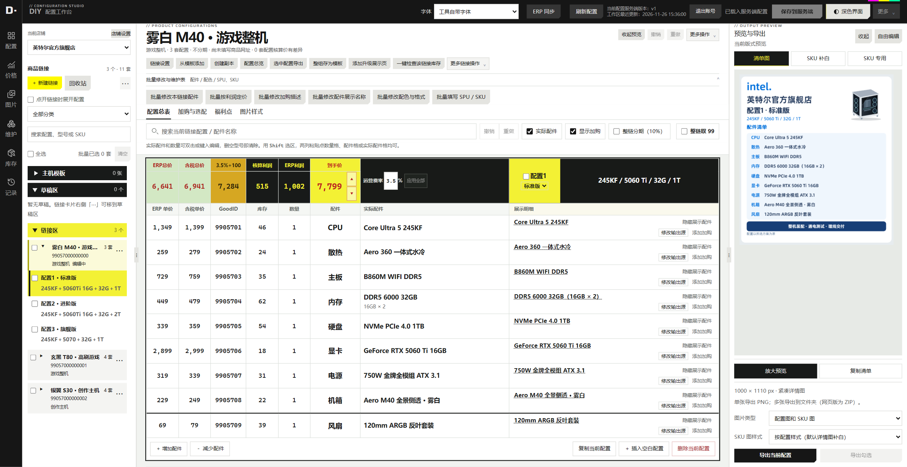
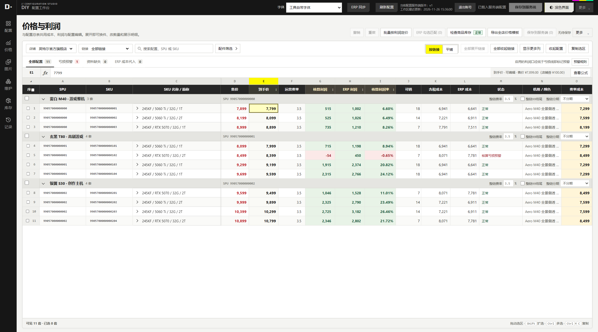
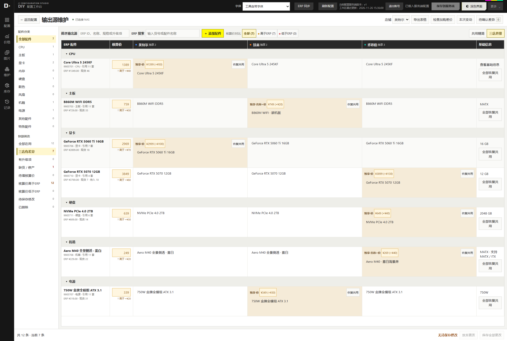
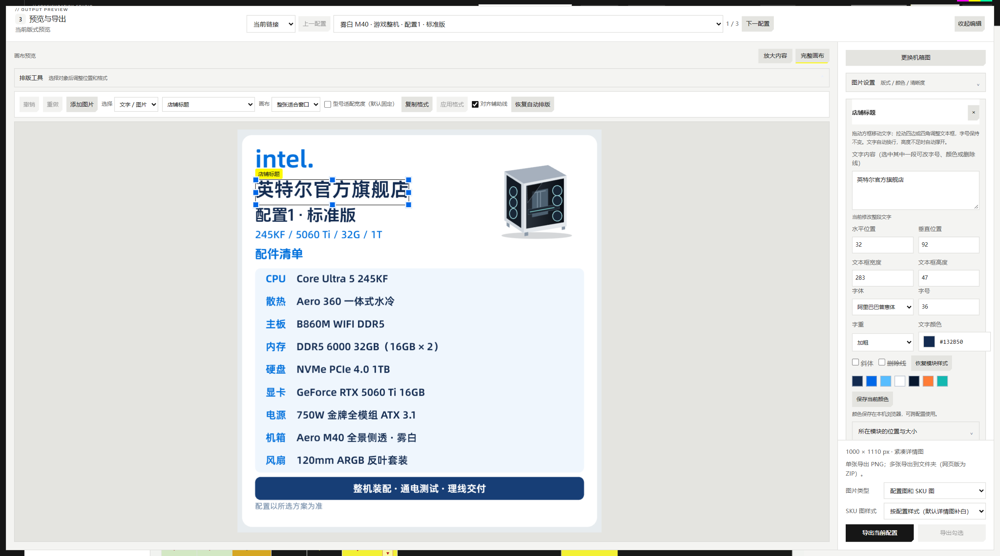

# 界面与操作

以下四张例图来自 0.2.57 的 NAS 工作台界面，配置、价格、成本、库存及机箱图均为合成示例。完整流程见 [使用说明](PUBLIC-USAGE.md)。

## 工作台布局

登录后，顶栏提供「字体」「ERP 同步」「刷新配置」「退出账号」「保存到服务端」、深浅界面切换和「更多」，并显示当前配置的服务端版本与工作区最近更新时间。编辑先写入本机草稿，点击「保存到服务端」后提交到 NAS。自动保存可从「更多 → 自动保存设置」调整。

左侧功能栏提供配置、图片、维护、价格、库存和记录入口。链接目录按当前店铺展示商品链接，点击配置可定位到连续总表。中间编辑配件和价格，右侧查看实时图片。空间不足时可收起预览。

每套配置的标题区显示到手价、ERP/核算成本与利润。启用分期时，括号内显示扣除分期费后的实际利润，手续费单独说明。正利润为绿色，负利润按程度区分橙色和红色。

链接操作区直接提供「链接设置」「从模板添加」「创建副本」「配置总览」「选中配置导出」「整组存为模板」「添加升级展示页」与「一键检查该链接库存」。「更多链接操作」内提供「导出回 WPS」和「图片标题与摘要」。

在「配置总览」中修改到手价，按 Enter 或离开输入框后更新草稿，定价、利润及复制定价同步使用新数值。按 Escape 可取消当前输入。返回配置总表后点击「保存到服务端」提交，维护表销售报价沿用原值。

## 连续表格

直接在展示或实际配件框输入型号、ERP ID，下方选择候选。候选同时显示价格和库存信息；展示名称与加购描述支持长文本换行。实际库存未知时显示“未知”，不会按零库存处理。

点击左侧配件行名选中行，Shift 连选、Ctrl 多选，然后 Ctrl+C 复制。点击目标行名后 Ctrl+V，按目标槽位粘贴展示、实际配件与关联加购内容；目标行不足时整次不粘贴，先新增行再试。输入框内的复制粘贴仍用于文字。

底部“＋ 新增配件”从配件6开始向后扩展。新增行下方的“删除”同时移除该行展示和实际配件；固定栏位的“清空”保留空白位置。删除中间行不会重新编号，保存和撤销均沿用工作台原流程。

ERP 固定表格格式仍最多到配件7；编辑器、保存和图片可保留更多配件。向 ERP 固定格式复制前需处理超出部分，程序会明确提示。

顶栏支持切换「浅色界面」和「深色界面」。导出图的深浅主题在「图片设置」中单独调整，按链接保存。

## 价格与利润

从左侧「价格」打开全屏工作表。可按链接分组或平铺，按链接、配置名、SPU、SKU 或实际配件筛选。到手价、ERP 与核算成本及对应利润共用配置总表的计算口径。展开某套配置可查看配件和成本细节。

工具栏提供「批量按利润定价」「ERP 勾选匹配」「检查商品库存」和「导出全店价格模板」。修改后点击「保存到服务端」提交，从「更多 → 返回配置」回到总表。

## 输出源维护

从左侧「维护 → 输出源维护」打开全屏工作表。用配件分类、搜索框或「核算价对比」缩小范围。在「共用精简」核对通用字段，授权覆盖三店时可切换「三店并排」对照各店名称、核算价及覆盖状态。

更改字段后用底栏「保存全部更改」提交。涉及跟随配置的更新时，可在「本次变动」或「待确认差异」核对影响。恢复共用后，该字段跟随共用值。

## 机箱图库

从左侧“图片 → 机箱图库”新增图片，选择 PNG 或 JPG（最大 24MB）后显示预览。图片名称独占一行，品牌/型号、颜色/版本采用两列紧凑排列。点击“保存图片”后显示处理状态，完成或失败均有提示；图库背景、文字、边框及按钮随工作台深浅主题切换。

## 自由编辑与导出

点击右侧预览的「自由编辑」打开全屏画布。顶部切换当前链接内的配置，左侧为画布和「排版工具」，右侧为图片设置、当前对象属性及导出。画布与属性区域各自滚动。

选择文字或图片对象后调整属性；文字支持直接修改，位置支持拖动与方向键微调。修改可撤销和重做。放大内容用于看清有效内容，完整画布用于检查边缘与补白；两种预览方式不会改变导出尺寸。

在预览底部选择仅配置图、仅 SKU 图或两者一起导出；SKU 图可选专用排版或详情图补白至 1:1。点击“导出当前配置”，或勾选配置后点击“导出勾选”。导出选择不修改已保存的预览排版。先等待图片任务完成，再核对实际保存目录；取消目录选择不算导出成功。

## 更多与诊断

顶栏「更多」提供连接设置、自动保存设置、检查更新、诊断和清理缓存。修改连接后保存并重启，从当前连接重新进入工作台。

## 维护数据按配件显示

选择 CPU、主板、机箱、显卡、内存或硬盘后，详情只显示对应的识别维护区。自动识别结果与人工值分开提示，机箱支持的主板板型可多选。板型搭配错误在配置中提示，不兼容的主板升级与加购默认隐藏，可在「升级与加购」中手动选择展示，详情图及 SKU 图遵从选择。详见 [使用说明](PUBLIC-USAGE.md)。
